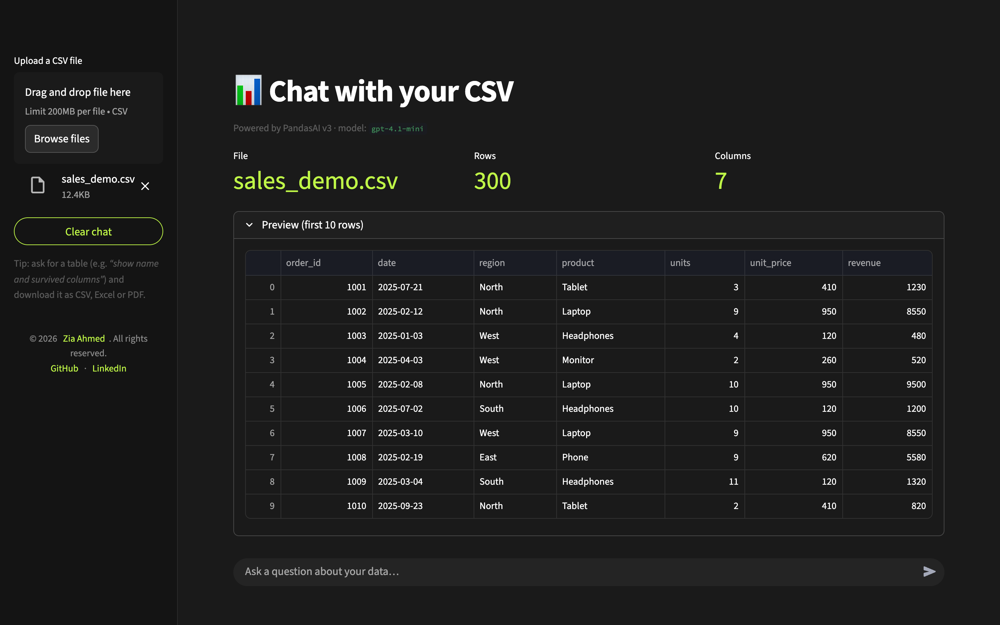
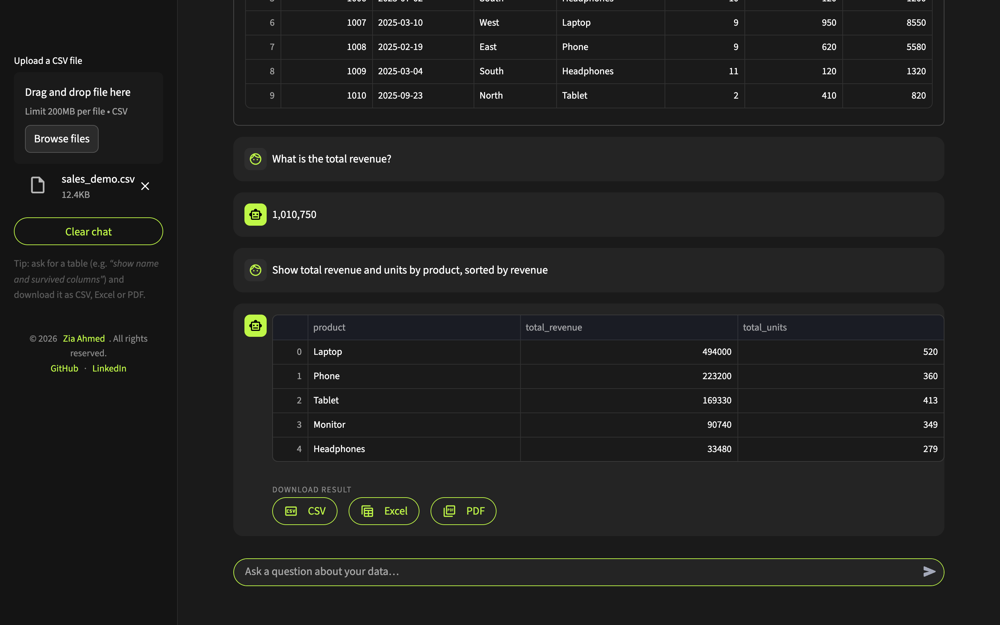

<div align="center">

# 📊 Chat with your CSV

**Exploratory data analysis in plain English, powered by [PandasAI v2](https://docs.pandas-ai.com/v2/library) and Streamlit. The AI writes real **pandas** code for every answer.**

Upload any CSV, ask questions like *“total revenue by region as a bar chart”*, and get answers as text, tables or charts. You can download the results as CSV, Excel, PDF or PNG.




</div>

---

## ✨ Features

| | |
|---|---|
| 📁 **CSV or Excel, no hardcoded data** | Upload `.csv`, `.xlsx` or `.xls` from the browser (with a sheet picker for multi-sheet workbooks). CSVs try UTF‑8 first, with an automatic **latin‑1 fallback**. |
| 🔎 **Instant overview** | File name, rows × columns, **column types** (dtype, missing, unique) and a preview of the first rows. |
| 🧑‍💻 **See the generated code** | Every answer has **Result / Generated Code** tabs showing the exact **pandas** code PandasAI wrote and ran on `dfs[0]` (`last_code_executed`), kept in chat history. |
| 💬 **Natural-language chat** | Ask questions in plain English. Chat history is kept per session and **resets when you upload a new file**. |
| 🧠 **Smart answer rendering** | Numbers and text are formatted cleanly, tables use `st.dataframe` and charts use `st.image`. |
| ⬇️ **One-click downloads** | Every table can be downloaded as **CSV, Excel or PDF**, and every chart as **PNG**. |
| ⏹️ **Stop button** | Cancel a long-running question at any time. |
| 🛡️ **Friendly errors** | Failures from PandasAI or the LLM show an `st.error` message with expandable details instead of crashing the app. |
| 🔌 **Any LLM** | Works with OpenAI, Anthropic, Gemini and more through a small [LiteLLM](https://docs.litellm.ai/) adapter ([`pandasai_v2_adapters.py`](pandasai_v2_adapters.py)). |

## 📸 Screenshots

<table>
  <tr>
    <td width="50%"></td>
    <td width="50%"></td>
  </tr>
  <tr>
    <td align="center"><b>Table answers</b> with CSV / Excel / PDF export</td>
    <td align="center"><b>Chart answers</b> with PNG export</td>
  </tr>
</table>

## 🚀 Quick start

**1. Clone the repo and create a virtual environment**

```bash
git clone https://github.com/ziaahmedf17/ExploratoryDataAnalysisWithAi.git
cd ExploratoryDataAnalysisWithAi
python3 -m venv .venv
source .venv/bin/activate        # Windows: .venv\Scripts\activate
pip install -r requirements.txt
```

**2. Add your API key**

```bash
cp .env.example .env
```

Then open `.env` and set your key:

```env
OPENAI_API_KEY=sk-...
LLM_MODEL=gpt-4.1-mini
```

> 🔒 `.env` is listed in `.gitignore`, so your key never gets committed.

**3. Run the app**

```bash
streamlit run app.py
```

Open **http://localhost:8501**, upload a CSV (try [`sample_data/sales_demo.csv`](sample_data/sales_demo.csv)) and start asking questions.

## ☁️ Deploy to Streamlit Community Cloud

1. Push this repo to GitHub, then go to [share.streamlit.io](https://share.streamlit.io) → **Create app** and pick the repo, branch `main` and main file `app.py`.
2. Under **Advanced settings**, choose **Python 3.11**. Pandas 1.5.3, which PandasAI 2.3.2 requires, has no wheels for Python 3.12+.
3. Paste your secrets (see [`.streamlit/secrets.toml.example`](.streamlit/secrets.toml.example)):

   ```toml
   APP_PASSWORD = "choose-a-strong-password"
   OPENAI_API_KEY = "sk-..."
   LLM_MODEL = "gpt-4.1-mini"
   ```

4. Deploy. Visitors must enter `APP_PASSWORD` before they can use the app, so strangers can't spend your API key. If an API key is set in secrets but `APP_PASSWORD` is missing, the app refuses to start.

> Settings are read from `st.secrets` first, then `.env` / environment variables for local runs.

## 🔁 Using a different LLM

The model is any [LiteLLM model string](https://docs.litellm.ai/docs/providers). Set `LLM_MODEL` and the matching key in `.env`:

| Provider | `LLM_MODEL` | Key variable |
|---|---|---|
| OpenAI | `gpt-4.1-mini` | `OPENAI_API_KEY` |
| Anthropic | `anthropic/claude-sonnet-5-5` | `ANTHROPIC_API_KEY` |
| Google | `gemini/gemini-2.5-flash` | `GEMINI_API_KEY` |

## 💡 Example questions

- *What is the total revenue?*
- *Show total revenue and units by product, sorted by revenue*
- *Plot a bar chart of total revenue by region*
- *Which month had the highest sales?*
- *Make a PDF of the product and revenue columns*. You'll get a table with download buttons.

## 🤔 Why PandasAI v2 and not v3?

The goal is for the AI to generate **pandas code on the dataframe**. PandasAI v3 can't do that: it routes all data access through SQL on DuckDB, and its code validator rejects any program that doesn't call `execute_sql_query` (`ExecuteSQLQueryNotUsed`). Even with explicit "pandas only, never SQL" instructions, all 5 test queries (average, group by, filter, top N, chart) still loaded data with `execute_sql_query("SELECT * FROM …")`. PandasAI v2's `SmartDataframe` generates plain pandas code on `dfs[0]`, and the same 5 queries produced 0 SQL.

## 🗂️ Project structure

```
.
├── app.py                 # Streamlit app (upload, chat, rendering, exports)
├── pandasai_v2_adapters.py # LiteLLM LLM + typed response parser for PandasAI v2
├── requirements.txt       # Python dependencies
├── .env.example           # Template for your API key + model (local runs)
├── .streamlit/config.toml # Theme + hides the Deploy button
├── .streamlit/secrets.toml.example # Secrets template for Streamlit Cloud
├── sample_data/           # Demo CSV to try the app
└── docs/screenshots/      # Images used in this README
```

## 🛠️ How it works

1. The uploaded file is read with `pandas.read_csv` (utf‑8 → latin‑1 fallback) or `pandas.read_excel`, and wrapped in a PandasAI v2 `SmartDataframe`.
2. Each question goes to `df.chat()`, which runs in a background thread so the **Stop** button stays responsive.
3. PandasAI generates **pandas** code (`dfs[0].groupby(...)`, filters, `sort_values`, matplotlib…) and executes it on your dataframe. The app shows that code (`last_code_executed`) in the **Generated Code** tab and renders the result by type (`number`, `string`, `dataframe` or `plot`).
4. Table answers are turned into CSV, Excel (`openpyxl`) and PDF (`fpdf2`) files in memory, ready to download.

---

<div align="center">

© 2026 **[Zia Ahmed](https://ziaahmed.dev)** · [GitHub](https://github.com/ziaahmedf17) · [LinkedIn](https://www.linkedin.com/in/ziaahmedf17/)

</div>
