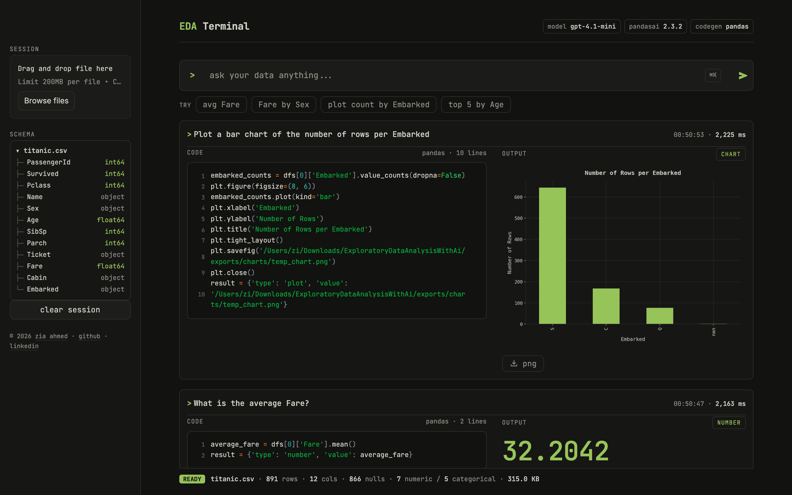
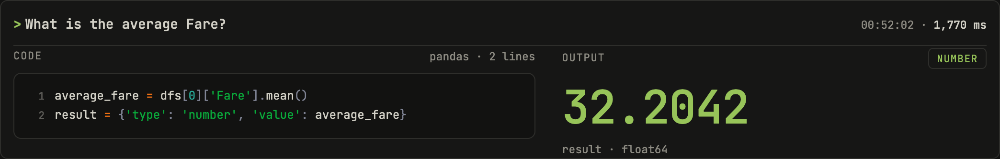
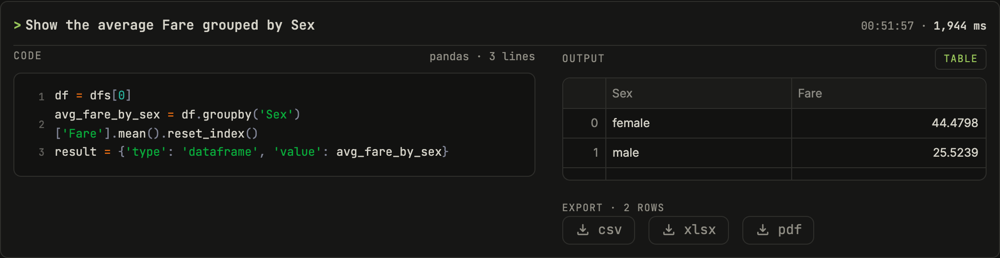
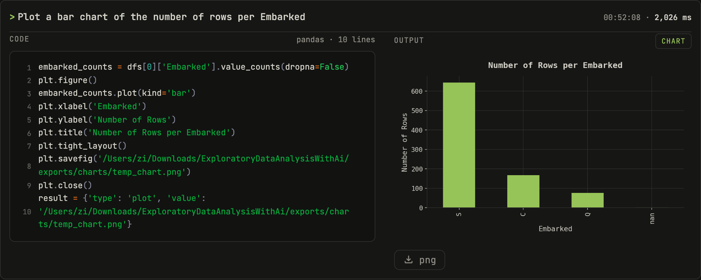
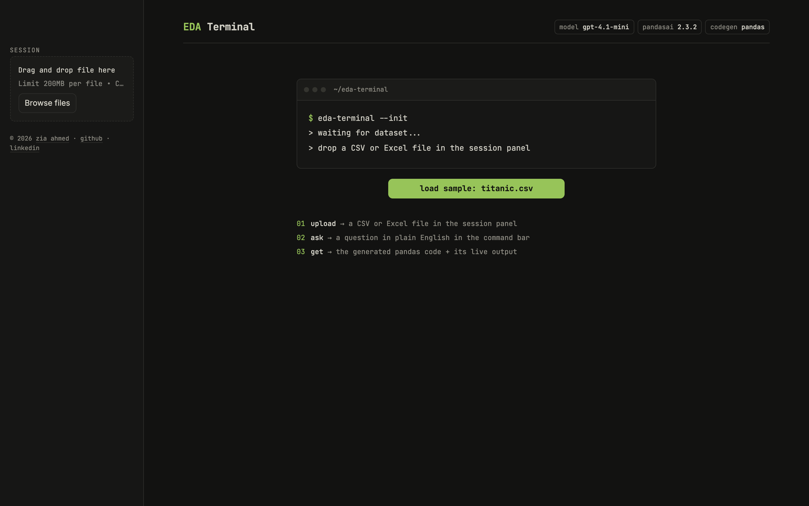
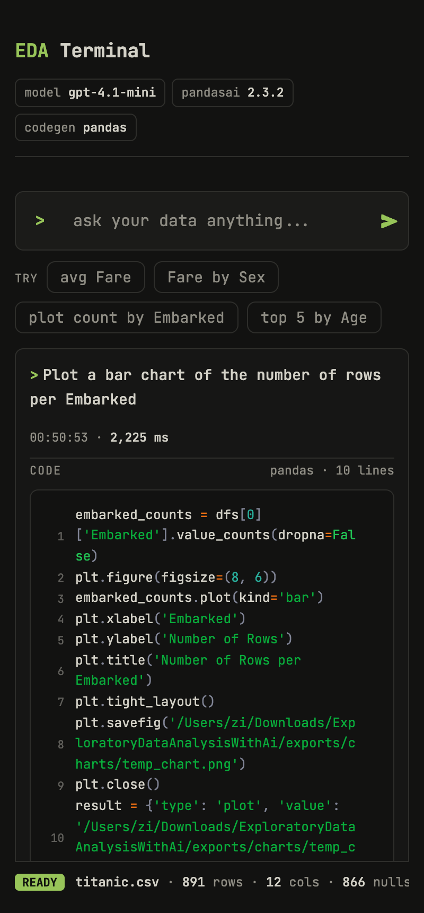

<div align="center">

# EDA Terminal

**Exploratory data analysis in plain English. Ask a question, get the pandas code and its output side by side.**

Upload a CSV or Excel file and ask something like *"average fare grouped by sex"*. [PandasAI v2](https://docs.pandas-ai.com/v2/library) writes real **pandas** code, runs it on your data, and EDA Terminal shows that code next to the result: a number, a table or a chart.




</div>

---

## Features

| | |
|---|---|
| **Split-terminal answers** | Every question becomes a block. The generated pandas code (with line numbers and a copy button) is on the left; the output is on the right, with a `NUMBER` / `TABLE` / `CHART` / `TEXT` badge, a timestamp and the run time in ms. |
| **Real pandas, not SQL** | PandasAI v2 generates code on the dataframe (`dfs[0].groupby(...)`, filters, `sort_values`, matplotlib). See [why not v3](#why-pandasai-v2-and-not-v3). |
| **Command bar** | A wide input at the top of the page. Press Enter to run; `Cmd+K` / `Ctrl+K` focuses it from anywhere. |
| **Suggested queries** | Four chips built from your dataset's own columns, such as `avg Fare`, `Fare by Sex`, `plot count by Embarked` and `top 5 by Age`. |
| **CSV or Excel** | Upload `.csv`, `.xlsx` or `.xls`, with a sheet picker for multi-sheet workbooks. CSVs try UTF-8 first and fall back to latin-1. |
| **Session panel** | The sidebar holds the upload box, a schema tree (column names and dtypes, numeric types in green) and a clear-session button. |
| **Status bar** | Pinned to the bottom like an editor footer: `file · rows · cols · nulls · numeric / categorical · memory`. |
| **Exports** | Tables download as **CSV, Excel or PDF**; charts download as **PNG**. |
| **Dark chart style** | Charts render on a transparent background with readable text, a subtle grid and a green / gray palette. |
| **Stop button** | Cancel a running query at any time. |
| **Clean errors** | Failures show a short red `ERR:` line, never a raw traceback. |
| **Private by default** | When deployed, visitors must enter `APP_PASSWORD` before they can use your API key. |
| **Any LLM** | OpenAI, Anthropic, Gemini and more, through a small [LiteLLM](https://docs.litellm.ai/) adapter ([`pandasai_v2_adapters.py`](pandasai_v2_adapters.py)). |

## Screenshots

**Answer blocks**: generated pandas code on the left, typed output on the right.







<table>
  <tr>
    <td width="68%"></td>
    <td width="32%"></td>
  </tr>
  <tr>
    <td align="center"><b>Empty state</b>: boot sequence and a one-click Titanic sample</td>
    <td align="center"><b>Mobile</b>: panes stack vertically</td>
  </tr>
</table>

## Quick start

**1. Clone the repo and install the dependencies** (Python 3.9 to 3.11)

```bash
git clone https://github.com/ziaahmedf17/ExploratoryDataAnalysisWithAi.git
cd ExploratoryDataAnalysisWithAi
python3 -m venv .venv
source .venv/bin/activate        # Windows: .venv\Scripts\activate
pip install -r requirements.txt
```

**2. Add your API key**

```bash
cp .env.example .env
```

Then open `.env` and set your key:

```env
OPENAI_API_KEY=sk-...
LLM_MODEL=gpt-4.1-mini
```

`.env` is in `.gitignore`, so your key never gets committed.

**3. Run the app**

```bash
streamlit run app.py
```

Open **http://localhost:8501** and click **load sample: titanic.csv**, or drop your own file in the session panel.

## Example questions

Using the bundled [`sample_data/titanic.csv`](sample_data/titanic.csv):

| Question | Output |
|---|---|
| *What is the average Fare?* | `NUMBER`: 32.2042 |
| *Show the average Fare grouped by Sex* | `TABLE`: female 44.48, male 25.52 |
| *Plot a bar chart of the number of rows per Embarked* | `CHART`: bar chart |
| *Show the top 5 rows with the highest Age* | `TABLE` |
| *Make a PDF of the Name and Survived columns* | `TABLE` with CSV / XLSX / PDF downloads |

A second sample, [`sample_data/sales_demo.csv`](sample_data/sales_demo.csv), has 300 orders (region, product, units, revenue).

## Deploy to Streamlit Community Cloud

1. Push this repo to GitHub, then go to [share.streamlit.io](https://share.streamlit.io), click **Create app**, and pick the repo, branch `main` and main file `app.py`.
2. Under **Advanced settings**, choose **Python 3.11**. PandasAI 2.3.2 requires pandas 1.5.3, which has no wheels for Python 3.12+.
3. Paste your secrets (see [`.streamlit/secrets.toml.example`](.streamlit/secrets.toml.example)):

   ```toml
   APP_PASSWORD = "choose-a-strong-password"
   OPENAI_API_KEY = "sk-..."
   LLM_MODEL = "gpt-4.1-mini"
   ```

4. Deploy. Visitors must enter `APP_PASSWORD` before they can run queries. If an API key is set in secrets but `APP_PASSWORD` is missing, the app refuses to start, so your key is never exposed by accident.

Settings are read from `st.secrets` first, then from `.env` / environment variables for local runs.

## Using a different LLM

`LLM_MODEL` is any [LiteLLM model string](https://docs.litellm.ai/docs/providers). Set it together with the matching key:

| Provider | `LLM_MODEL` | Key variable |
|---|---|---|
| OpenAI | `gpt-4.1-mini` | `OPENAI_API_KEY` |
| Anthropic | `anthropic/claude-sonnet-5-5` | `ANTHROPIC_API_KEY` |
| Google | `gemini/gemini-2.5-flash` | `GEMINI_API_KEY` |

## How it works

1. The file is read with `pandas.read_csv` (UTF-8, falling back to latin-1) or `pandas.read_excel`, and wrapped in a PandasAI v2 `SmartDataframe`.
2. A question from the command bar or a chip goes to `df.chat()` in a background thread, so the **Stop** button stays responsive.
3. PandasAI asks the LLM for pandas code, runs it on your dataframe and returns a typed result (`number`, `string`, `dataframe` or `plot`). If the LLM replies without code, the app retries once.
4. The answer block shows the executed code (`last_code_executed`) and renders the result by type. Charts use a preconfigured dark matplotlib style.
5. Table results are turned into CSV, Excel (`openpyxl`) and PDF (`fpdf2`) files in memory, ready to download.

## Why PandasAI v2 and not v3?

The goal is for the AI to write **pandas code on the dataframe**. PandasAI v3 can't do that: it routes all data access through SQL on DuckDB, and its code validator rejects any program that doesn't call `execute_sql_query` (`ExecuteSQLQueryNotUsed`). Even with explicit "pandas only, never SQL" instructions, all 5 test queries (average, group by, filter, top N, chart) still loaded data with `execute_sql_query("SELECT * FROM ...")`. PandasAI v2's `SmartDataframe` generates plain pandas code on `dfs[0]`, and the same 5 queries produced no SQL at all.

## Project structure

```
.
├── app.py                          # EDA Terminal: UI, upload, query blocks, exports
├── pandasai_v2_adapters.py         # LiteLLM LLM + typed response parser for PandasAI v2
├── requirements.txt                # Pinned dependencies (tested on Python 3.9 and 3.11)
├── .env.example                    # API key + model template (local runs)
├── .streamlit/config.toml          # Terminal theme, fonts, hidden toolbar
├── .streamlit/secrets.toml.example # Secrets template for Streamlit Cloud
├── sample_data/                    # titanic.csv and sales_demo.csv
└── docs/screenshots/               # Images used in this README
```

---

<div align="center">

&copy; 2026 **[Zia Ahmed](https://ziaahmed.dev)** &middot; [GitHub](https://github.com/ziaahmedf17) &middot; [LinkedIn](https://www.linkedin.com/in/ziaahmedf17/)

</div>
