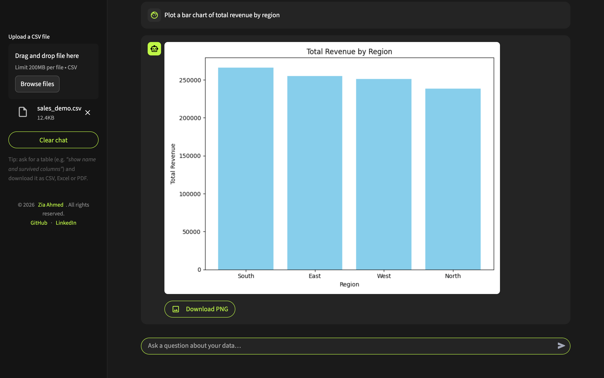

<div align="center">

# 📊 Chat with your CSV

**Exploratory data analysis in plain English, powered by [PandasAI v3](https://docs.pandas-ai.com/v3/introduction) and Streamlit.**

Upload any CSV, ask questions like *“total revenue by region as a bar chart”*, and get answers as text, tables or charts. You can download the results as CSV, Excel, PDF or PNG.


</div>

---

## ✨ Features

| | |
|---|---|
| 📁 **Any CSV, no hardcoded data** | Upload from the browser. UTF‑8 is tried first, with an automatic **latin‑1 fallback** for messy files. |
| 🔎 **Instant overview** | File name, rows × columns and a preview of the first rows. |
| 💬 **Natural-language chat** | Ask questions in plain English. Chat history is kept per session and **resets when you upload a new file**. |
| 🧠 **Smart answer rendering** | Numbers and text are formatted cleanly, tables use `st.dataframe` and charts use `st.image`. |
| ⬇️ **One-click downloads** | Every table can be downloaded as **CSV, Excel or PDF**, and every chart as **PNG**. |
| ⏹️ **Stop button** | Cancel a long-running question at any time. |
| 🛡️ **Friendly errors** | Failures from PandasAI or the LLM show a helpful message instead of crashing the app. |
| 🔌 **Any LLM** | Works with OpenAI, Anthropic, Gemini and more via [`pandasai-litellm`](https://docs.pandas-ai.com/v3/large-language-models). |

## 📸 Screenshots

<table>
  <tr>
    <td width="50%"></td>
    <td width="50%"></td>
  </tr>
  <tr>
    <td align="center"><b>Table answers</b> with CSV / Excel / PDF export</td>
    <td align="center"><b>Chart answers</b> with PNG export</td>
  </tr>
</table>

## 🚀 Quick start

**1. Clone the repo and create a virtual environment**

```bash
git clone https://github.com/ziaahmedf17/ExploratoryDataAnalysisWithAi.git
cd ExploratoryDataAnalysisWithAi
python3 -m venv .venv
source .venv/bin/activate        # Windows: .venv\Scripts\activate
pip install -r requirements.txt
```

**2. Add your API key**

```bash
cp .env.example .env
```

Then open `.env` and set your key:

```env
OPENAI_API_KEY=sk-...
LLM_MODEL=gpt-4.1-mini
```

> 🔒 `.env` is listed in `.gitignore`, so your key never gets committed.

**3. Run the app**

```bash
streamlit run app.py
```

Open **http://localhost:8501**, upload a CSV (try [`sample_data/sales_demo.csv`](sample_data/sales_demo.csv)) and start asking questions.

## 🔁 Using a different LLM

The model is any [LiteLLM model string](https://docs.litellm.ai/docs/providers). Set `LLM_MODEL` and the matching key in `.env`:

| Provider | `LLM_MODEL` | Key variable |
|---|---|---|
| OpenAI | `gpt-4.1-mini` | `OPENAI_API_KEY` |
| Anthropic | `anthropic/claude-sonnet-5-5` | `ANTHROPIC_API_KEY` |
| Google | `gemini/gemini-2.5-flash` | `GEMINI_API_KEY` |

## 💡 Example questions

- *What is the total revenue?*
- *Show total revenue and units by product, sorted by revenue*
- *Plot a bar chart of total revenue by region*
- *Which month had the highest sales?*
- *Make a PDF of the product and revenue columns*. You'll get a table with download buttons.

## 🗂️ Project structure

```
.
├── app.py                 # Streamlit app (upload, chat, rendering, exports)
├── requirements.txt       # Python dependencies
├── .env.example           # Template for your API key + model
├── .streamlit/config.toml # Theme + hides the Deploy button
├── sample_data/           # Demo CSV to try the app
└── docs/screenshots/      # Images used in this README
```

## 🛠️ How it works

1. The uploaded file is read with `pandas.read_csv` (utf‑8 → latin‑1 fallback) and wrapped in `pai.DataFrame(...)`.
2. Each question goes to `df.chat()`, which runs in a background thread so the **Stop** button stays responsive.
3. PandasAI writes and runs SQL/Python against your data. The app checks the response type (`number`, `string`, `dataframe` or `chart`) and renders it accordingly.
4. Table answers are turned into CSV, Excel (`openpyxl`) and PDF (`fpdf2`) files in memory, ready to download.

---

<div align="center">

© 2026 **[Zia Ahmed](https://ziaahmed.dev)** · [GitHub](https://github.com/ziaahmedf17) · [LinkedIn](https://www.linkedin.com/in/ziaahmedf17/)

</div>
